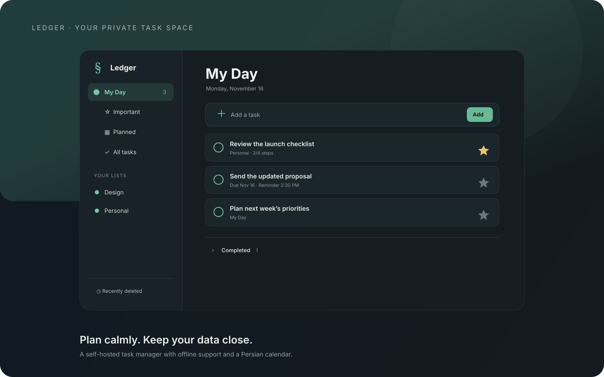
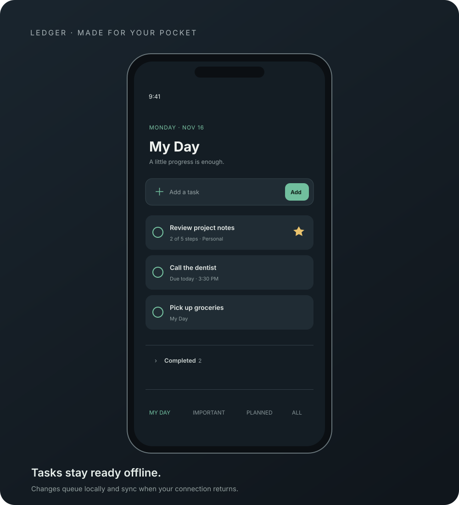

<div align="center">

# Ledger

### Plan calmly. Keep your data close.

A self-hosted task manager for focused days, Persian calendar planning, and quick capture from your terminal.

[Features](#features) · [Install on your server](#install-on-your-server) · [CLI](#cli) · [How it works](#how-it-works)

<br />



<br />



</div>

---

## Why Ledger?

Ledger gives you a calm task space that you run yourself. Use it in a browser, install it on your phone as a progressive web app, or capture tasks from the command line. Your task database stays on your server.

| Plan | Do | Keep |
| --- | --- | --- |
| Jalali calendar and date-based tasks | Steps, reminders, repeats, and notes | Self-hosted MySQL or MariaDB |
| My Day, Important, Planned, and custom lists | Installable mobile and desktop PWA | Offline edits with automatic sync |
| Theme colors and optional backgrounds | Web Push reminders on supported browsers | CLI cache for quick capture |

## Features

- **A clear daily flow.** My Day, Important, Planned, All tasks, Calendar, and your own lists each have a focused purpose.
- **Persian calendar planning.** Pick a Jalali date, see tasks planned for that day, and add a new task directly to it.
- **Useful task details.** Break work into steps, add notes, set due dates and reminders, and schedule repeating tasks.
- **Offline access.** The installed PWA can open its cached app shell and last synced task list. Changes made offline stay on the device and sync when a connection returns.
- **Live updates.** Open clients refresh from the server while online, so changes show up without a manual reload.
- **Web Push reminders.** Supported Android and desktop browsers can receive reminders while Ledger is closed, provided the phone and your Ledger server can reach the internet.
- **Recently deleted.** Removed tasks stay recoverable for 24 hours.
- **A small CLI.** Add, complete, edit, and sync tasks from a terminal.
- **Your own look.** Choose a color theme and an optional background image.

> **Push delivery note:** the phone must have internet access and the Ledger server must be running when the reminder is due. A fully offline phone cannot receive a push notification until it reconnects.

## Install on your server

On a fresh Ubuntu or Debian server, connect over SSH and run this single command as an administrator:

```bash
curl -fsSL https://raw.githubusercontent.com/mohammadsdg/Ledger/main/deploy.sh | sudo bash
```

The Ledger installer downloads the project to `/opt/ledger` and opens an interactive menu. Choose **Install Ledger** to install Node.js and MySQL, create the database and a restricted database user, ask you to choose the Ledger sign-in password, build the app, and register it as a system service. It finishes with a health check and prints the address to open.

The menu remains available for future maintenance:

| Menu action | What it does |
| --- | --- |
| Install Ledger | Prepare a fresh server and start Ledger |
| Update Ledger | Pull the latest version, rebuild, and restart |
| Check service and health | Show systemd status and call the health endpoint |
| Restart / stop | Control the Ledger service |
| View recent logs | Read recent systemd logs |
| Back up the database | Create a timestamped SQL backup |
| Apply schema upgrade | Apply the idempotent database schema |
| Remove service | Remove the service while keeping project files and database |

To open the menu later:

```bash
sudo /opt/ledger/deploy.sh menu
```

Automatic fresh installation supports Ubuntu and Debian. Other Linux distributions can use the included menu after installing Node.js 20+, MySQL/MariaDB, curl, git, and systemd. HTTPS is needed for PWA installation and push notifications; put Ledger behind a reverse proxy such as Nginx and enable TLS.

### Manual development setup

For local development, install Node.js 20.19+ and MySQL 8+ (or compatible MariaDB), then:

```bash
git clone https://github.com/mohammadsdg/Ledger.git
cd Ledger
mysql -u root -p < schema.sql
cd server
npm ci
cp .env.example .env
npm run dev
```

Configure `server/.env` with your app password, session secret, and database connection values. For a production build, run:

```bash
npm run build
npm start
```

Open <http://localhost:4000> and sign in with `APP_PASSWORD`.

## Phone install and reminders

Put Ledger behind HTTPS, open it on your phone, then choose **Install app** or **Add to Home Screen**. In Ledger, enable notifications and allow the browser permission. Set reminders from a task’s details.

The server generates and stores VAPID keys automatically. To provide your own keys, set `VAPID_PUBLIC_KEY`, `VAPID_PRIVATE_KEY`, and `VAPID_SUBJECT` in the environment. The server must remain available to send scheduled reminders.

## CLI

The CLI is an offline-first companion for quick capture. See the [CLI guide](cli/README.md) for all commands and configuration.

```bash
cd cli
npm link
export TODO_API_URL=https://tasks.example.com/api
export TODO_PASSWORD='the-same-value-as-APP_PASSWORD'

todo add "buy milk" -today
todo list all
todo done 1
todo push
```

The CLI cache lives at `~/.todo-cli/cache.json`. `todo push` and `todo fetch` perform a two-way sync.

## How it works

```text
Browser / installed PWA ── authenticated API ── Node.js server ── MySQL
          │                                      │
          ├── local task cache                   └── Web Push reminders
          └── queued offline edits

CLI ── local cache ── same authenticated API
```

- **Web app:** React, Material UI, Vite, and a service worker
- **API:** Express with signed HTTP-only browser sessions
- **Storage:** MySQL/MariaDB with transactional per-task synchronization
- **Offline behavior:** local cache and queued edits; the server resolves concurrent changes using task timestamps
- **Reminders:** Web Push delivered by the Node server

## Self-hosting details

Ledger listens on port `4000` by default. The installer uses systemd to keep the service running. You can inspect it with:

```bash
sudo systemctl status ledger
sudo journalctl -u ledger -n 100 --no-pager
curl http://127.0.0.1:4000/healthz
```

A small Nginx reverse proxy can forward requests to Ledger:

```nginx
server {
    listen 80;
    server_name tasks.example.com;

    location / {
        proxy_pass http://127.0.0.1:4000;
        proxy_http_version 1.1;
        proxy_set_header Host $host;
        proxy_set_header X-Real-IP $remote_addr;
        proxy_set_header X-Forwarded-For $proxy_add_x_forwarded_for;
        proxy_set_header X-Forwarded-Proto $scheme;
    }
}
```

Enable HTTPS before using the PWA install flow or Web Push, and set `NODE_ENV=production` so session cookies use the `Secure` flag.

For a dedicated MySQL user, grant access only to the Ledger database:

```sql
CREATE USER 'ledger'@'localhost' IDENTIFIED BY 'use-a-strong-password';
GRANT SELECT, INSERT, UPDATE, DELETE ON ledger.* TO 'ledger'@'localhost';
FLUSH PRIVILEGES;
```

## Project layout

```text
Ledger/
├── deploy.sh                 One-command deploy and interactive menu
├── schema.sql                MySQL schema and upgrades
├── docs/images/              README product previews
├── server/
│   ├── server.js             API, authentication, sync, and reminders
│   ├── db.js                 MySQL connection and state loading
│   └── web/                  React PWA
└── cli/                      Offline-first terminal client
```

## Development checks

```bash
cd server
npm ci
npm run dev
npm run check
```
